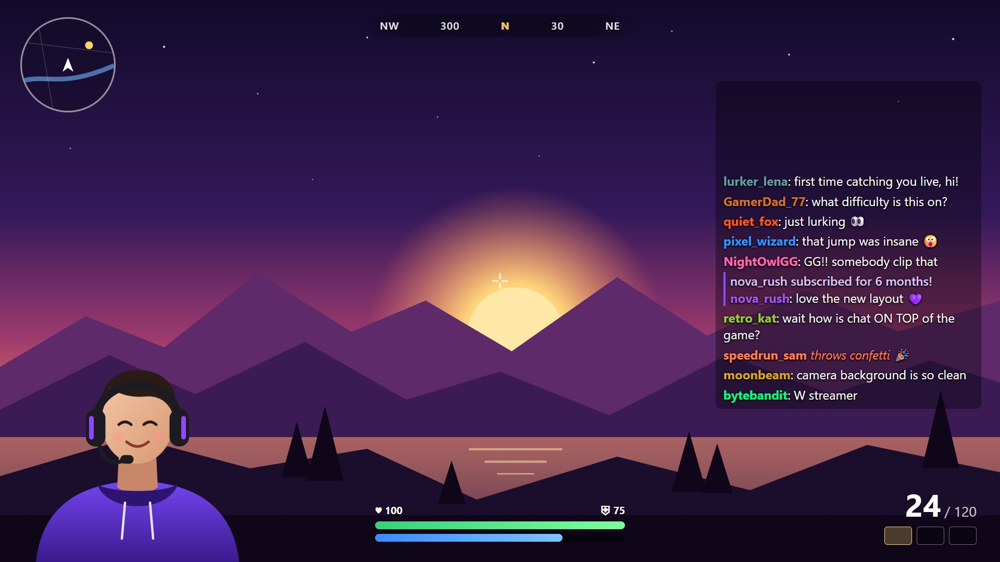
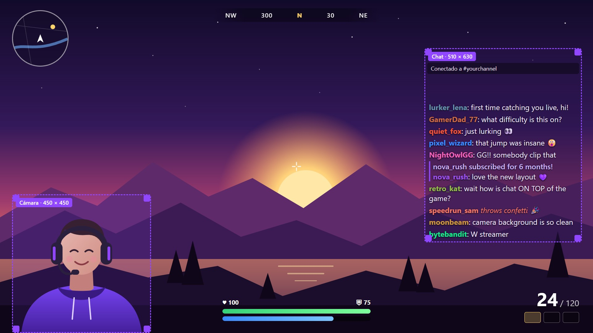
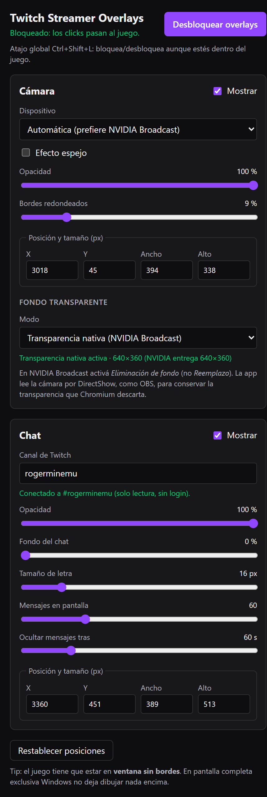
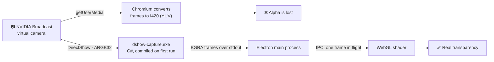
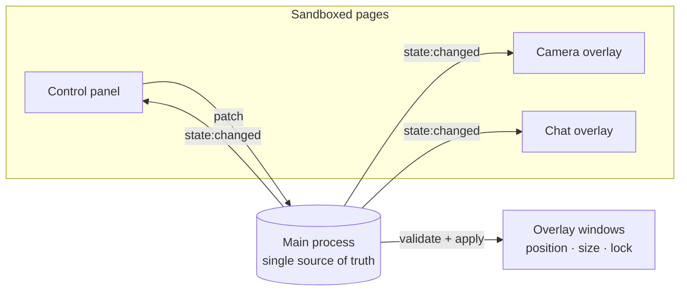

<p align="center">
  
</p>

<h1 align="center">Twitch Streamer Overlays</h1>

<p align="center">
  <b>Your webcam and your Twitch chat, floating on top of your game.</b><br>
  Drag them, resize them, lock them and keep playing.
</p>

<p align="center">
  
  
  
  
</p>

<p align="center">
  <a href="https://github.com/RogerMinemu/twitch-streamer-overlays/releases/latest"></a>
</p>

<p align="center">
  
</p>

<p align="center"><sub>Mock-up rendered with the app's real overlay styles. Chatters are fictional.</sub></p>

> 🇪🇸 [Leer en español](README.es.md)

## Why

Streaming on one monitor means you can't see your camera or your chat while you play, and alt-tabbing to OBS breaks the game. This app draws both **on top of the game** as small always-on-top windows. Once you lock them, **every click goes straight through to the game**.

## Features

| | |
| --- | --- |
| 🎥 **Camera overlay** | Any webcam. With **NVIDIA Broadcast** it keeps the **real transparency** of *Background removal*: no green screen needed. |
| 💬 **Twitch chat overlay** | Live and read-only. **No login, no token**: just type the channel name. Handles emotes, `/me`, subs and raids, deleted messages, timeouts and bans. |
| 🖱️ **Drag & resize** | Move each overlay anywhere and resize it from any edge or corner, or type exact X / Y / width / height. |
| 🌫️ **Per-overlay opacity** | Each overlay has its own opacity. The chat also has background opacity, font size, max messages and message lifetime. |
| 🔒 **Lock = click-through** | Locked overlays ignore the mouse, so they can't be moved by accident and never steal a click from the game. |
| ⌨️ **Global hotkey** | <kbd>Ctrl</kbd>+<kbd>Alt</kbd>+<kbd>Shift</kbd>+<kbd>L</kbd> locks and unlocks even while you're in-game. The tray icon works as a backup. |
| 💾 **Remembers everything** | Positions, sizes and settings are saved automatically. |

## Edit mode vs. locked mode

<table>
  <tr>
    <th width="50%">✏️ Edit mode</th>
    <th width="50%">🔒 Locked (playing)</th>
  </tr>
  <tr>
    <td></td>
    <td></td>
  </tr>
  <tr>
    <td>Dashed purple frame: drag from anywhere and resize from the edges. The label shows the real size in pixels.</td>
    <td>No frames. The overlays are click-through, so the mouse only talks to the game.</td>
  </tr>
</table>

## Control panel

<table>
  <tr>
    <td width="330"></td>
    <td>

Everything is set from a single window:

- **Camera:** device (picks NVIDIA Broadcast automatically), mirror, opacity, rounded corners, exact position and size, and the background mode.
- **Chat:** channel, opacity, background, font size, how many messages to show and how long they stay.
- **Lock / unlock**, plus the hotkey that is currently active.
- **Reset positions**, if an overlay ends up somewhere you can't reach.

Closing the panel doesn't quit the app: it stays in the system tray. To exit, use tray → *Salir* (Quit).

<sub>Real screenshot. The UI is currently in Spanish.</sub>

</td>
  </tr>
</table>

## Getting started

### Download

Get **`TwitchStreamerOverlays-Setup-<version>.exe`** from the [latest release](https://github.com/RogerMinemu/twitch-streamer-overlays/releases/latest) and run it. If you'd rather not install anything, there is also a portable version. You need Windows 10 or 11; NVIDIA Broadcast is optional.

> [!NOTE]
> The executables are **not code-signed**. The first time you run one, Windows SmartScreen shows *"Windows protected your PC"*. Click **More info → Run anyway**. Each release lists SHA-256 checksums so you can verify the download.

### Run from source

**Requirements:** Windows 10 or 11 and [Node.js](https://nodejs.org) 20+.

```bash
git clone https://github.com/RogerMinemu/twitch-streamer-overlays.git
cd twitch-streamer-overlays
npm install
npm start
```

### Build the Windows `.exe`

```bash
npm run dist
```

You get two files in `dist/`:

| File | What it is |
| --- | --- |
| `Twitch Streamer Overlays Setup 0.1.0.exe` | **Installer.** Per-user install (no admin rights), with shortcuts and an uninstaller. Fast startup. |
| `Twitch Streamer Overlays 0.1.0 Portable.exe` | **Portable.** Installs nothing, but unpacks itself to a temp folder on every launch, so it starts a few seconds slower. |

## How to use

1. On first launch, the **control panel** opens together with both overlays in **edit mode**.
2. Drag each overlay into place and resize it from its edges or corners.
3. In the panel, type your Twitch channel and pick your camera.
4. Press **Bloquear overlays** (lock overlays) or <kbd>Ctrl</kbd>+<kbd>Alt</kbd>+<kbd>Shift</kbd>+<kbd>L</kbd>. Now play.
5. To edit again, press the same hotkey or use the purple tray icon.

If another app already owns the hotkey, the app falls back to <kbd>Ctrl</kbd>+<kbd>Alt</kbd>+<kbd>Shift</kbd>+<kbd>O</kbd> and then <kbd>Ctrl</kbd>+<kbd>Alt</kbd>+<kbd>F12</kbd>. The panel shows which one is active.

> [!IMPORTANT]
> Run your game in **borderless windowed** mode. In exclusive fullscreen, Windows doesn't let any window draw on top of the game. That is an operating system limit, not something this app can work around.

## NVIDIA Broadcast with real transparency

1. In NVIDIA Broadcast → Camera, enable **Background removal**.
2. In the panel, set *Fondo transparente* (transparent background) to **Transparencia nativa (NVIDIA Broadcast)**.

### Why a native helper?

NVIDIA Broadcast publishes frames **with an alpha channel**, but Chromium (and so every Electron app) converts camera frames to I420 YUV, a format **without alpha**. The transparency is gone before the page ever sees the frame, and no shader can bring it back.

So the app reads the camera the same way OBS does: through **DirectShow in ARGB32**, using a small C# helper.



What the helper (`native/dshow-capture.cs`) does:

- **Builds itself:** it is compiled on first use with the C# compiler that ships with Windows (.NET Framework 4 `csc.exe`), so there is nothing to install. The result is cached in `%APPDATA%\Twitch Streamer Overlays\native\` and only rebuilt when the source changes.
- **Sends only the pixels you need:** it scales each frame down to the overlay's real size and flips it, because DirectShow delivers rows bottom-up.
- **Doesn't fail on picky drivers:** NVIDIA Broadcast *lists* 12 resolutions, but on the test machine its pin sometimes only *accepted* 3840×2160. The helper tries the formats in order and scales down on the CPU when needed (about 3% of one core).
- **Exits when the app exits.**

To diagnose other cameras:

```bash
dshow-capture.exe --list                                                # formats each camera advertises
dshow-capture.exe --probe-connect --device "Camera (NVIDIA Broadcast)"  # formats it actually accepts
```

### Other background modes

- **Chroma key:** click *Generar imagen verde* (generate green image), use it in NVIDIA Broadcast → *Background replacement* and choose **Chroma key**. It uses the same math as OBS's chroma key filter.
- **Cut black (luma key):** needs no NVIDIA setup, but it also removes dark areas such as black hair or clothes.

## Configuration

Everything is saved automatically to `%APPDATA%\Twitch Streamer Overlays\settings.json`.

To change the hotkey, edit `hotkeys.toggleLock` there (an [Electron accelerator](https://www.electronjs.org/docs/latest/api/accelerator), e.g. `CommandOrControl+Alt+Shift+L`) and restart the app.

## How it's built



**One-way data flow:** the panel sends *patches*. The main process validates them against a whitelist, applies them to the real windows and broadcasts the new state. Pages only render what they receive, so nothing can drift out of sync.

```
src/
  main/
    main.js                   Startup, permissions, hardening
    overlay-controller.js     Single source of truth: windows, lock, resize, IPC, broadcast
    settings-store.js         Settings on disk, validated field by field
    app-protocol.js           Serves src/renderer as app://overlay (secure context)
    tray.js                   Tray icon (drawn in code)
    green-screen-image.js     Generates the green PNG for chroma key mode
    native-camera.js          Helper process: start, debounced restarts, frame parser
    native-capture-helper.js  Compiles native/dshow-capture.cs with Windows' csc (cached by hash)
  preload/preload.js          The only bridge exposed to the pages (contextBridge)
  renderer/
    shared/                   Edit frame: border, size label and resize handles
    camera/                   getUserMedia or native frames + WebGL shader (native alpha / chroma / luma)
    chat/                     Twitch IRC over WebSocket + safe rendering (no innerHTML)
    panel/                    Control panel with declarative data-bind bindings
native/
  dshow-capture.cs            DirectShow ARGB32 capture → BGRA frames over stdout
```

A few decisions worth knowing:

- **Custom resize.** On Windows, transparent frameless windows can't be resized natively. While you drag a handle, the main process follows the real cursor position (`screen.getCursorScreenPoint`). The renderer's `screenX` jitters, because the window moves under the pointer.
- **Security.** Pages run sandboxed with context isolation and a strict CSP. Only the camera permission is granted, and only to the app's own pages. Navigation and pop-ups are blocked. Chat text is untrusted, so it is rendered with `textContent` only.

## Known limitations

- **Windows only.** The native capture uses DirectShow. Tested on Windows 11.
- **No exclusive fullscreen.** Use borderless windowed (see above).
- **No Twitch badges** (mod, sub, etc.). They need the Helix API with a token, and the chat is deliberately login-free.
- **UI in Spanish.**
- **Unsigned executables**, so SmartScreen warns on the first run.
